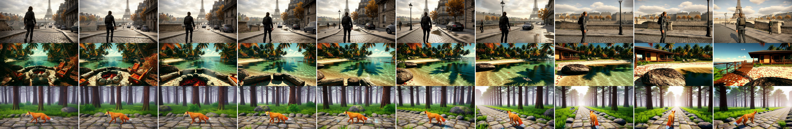

# ComfyUI-Hy-Nomas

<p align="center">
  
  
  
  
</p>

<p align="center">
  <a href="https://huggingface.co/PedroMarinhoDev/Hy-Nomas-ComfyUI"><b>Model files on Hugging Face</b></a> ·
  <a href="#samples"><b>Samples</b></a> ·
  <a href="#quick-start"><b>Quick start</b></a> ·
  <a href="workflows"><b>Workflows</b></a> ·
  <a href="https://huggingface.co/tencent/Hy-Nomas"><b>The original model</b></a>
</p>

Run Tencent's **[Hy-Nomas](https://huggingface.co/tencent/Hy-Nomas)** video world model **natively in ComfyUI**: a
world generated one segment at a time, each segment continuing from the model's memory of the earlier ones, steered
by text, timed actions and the camera. Start it from a prompt or **from your own image**, chain as many segments as
you like, or **drive** it with the keyboard turn by turn. The DiT is a native ComfyUI `MODEL` sampled by the stock
`KSampler` and streamed by ComfyUI's own memory management, on Tencent's INT8 distilled weights; it runs on 12 GB
cards at nearly full speed.

> [!IMPORTANT]
> **Work in progress.** These nodes work end to end and are checked against Tencent's code, but they are young:
> expect rough edges, changing node inputs and missing pieces. More features and optimizations are planned, see
> [Roadmap](#roadmap). Issues and feedback are welcome.

## Samples

All three are 20 s at 1280x704, 24 fps: four 5 s segments chained, each with its own text, after the image's
segment for the first two. RTX 4090, about 3 minutes each. Click a preview for the full video.

| From an image: Paris | From an image: a beach | From text only |
|:--:|:--:|:--:|
| [](https://huggingface.co/PedroMarinhoDev/Hy-Nomas-ComfyUI/resolve/main/samples/paris_from_image_720p.mp4) | [](https://huggingface.co/PedroMarinhoDev/Hy-Nomas-ComfyUI/resolve/main/samples/beach_from_image_720p.mp4) | [](https://huggingface.co/PedroMarinhoDev/Hy-Nomas-ComfyUI/resolve/main/samples/fox_720p.mp4) |
| Third-person follow. She walks down to the river road, stops at the wall to look at the bridge, the sun breaks through, she walks on. | First person. Past the fire pit to the water's edge, a turn along the shore, onto the deck by the hut. | The fox walks the path, stops and turns to the camera, then trots off into the forest as sunbeams break through the fog. |



<sub>Every 2 s of each sample; the first frame of the top two rows is the start image. Their worlds:
[`examples/`](examples) (`paris_from_image.json`, `beach_from_image.json`, `fox.json`).</sub>

## What you get

- **Worlds from text**: Tencent's structured world prompt (style, perspective, subject, timed segments), cut into
  per-segment prompts exactly as the reference does, with the per-action attention masks.
- **Start from an image**: a picture becomes the world's first segment and the world continues from it. Hy-Nomas has
  no image input; this puts the image in its memory, and the look carries over well (see [below](#start-from-an-image)).
- **Long, chained worlds**: add segments and keep going; history beyond the last 18 latent frames stays in system RAM.
- **Camera control**: fly a path inside the node with W/A/S/D and the arrows (Tencent's web-demo controls), or type
  a key timeline.
- **Drive mode**: steer the world with the keyboard while it generates one short turn after another and streams the
  frames into the node.
- **Fast on consumer cards**: int8 tensor-core GEMMs on Tencent's int8 weights, fused kernels, FP8 decoder, int8
  history. 12 GB cards run at nearly the speed of a 24 GB one.

## What you need

| | |
|---|---|
| GPU | NVIDIA, 12 GB or more (RTX 4090 tested; 16 GB and 12 GB simulated, see [Speed](#speed-and-memory)). The fast paths use the int8 tensor cores (RTX 30 and newer) and FP8 for the decoder (RTX 40 and newer). |
| RAM | 32 GB at least; more for long worlds. The history grows ~5.9 GB per 5 s segment at 1280x704, ~2.3 GB at 832x480. |
| Disk | ~27 GB: the INT8 DiT (9 GB), the FP8 decoder (9 GB, also holds the encoder), the text encoder (9 GB). |
| ComfyUI | a current version (tested on 0.42). Nothing to `pip install`: the nodes use what ComfyUI ships (comfy-kitchen, Triton). |

## Quick start

1. **Install the nodes** and restart ComfyUI.

   ```bash
   cd ComfyUI/custom_nodes
   git clone https://github.com/PedroMarinhoDev/ComfyUI-Hy-Nomas
   ```

2. **Download the weights** (Tencent's files, renamed for ComfyUI, from
   [PedroMarinhoDev/Hy-Nomas-ComfyUI](https://huggingface.co/PedroMarinhoDev/Hy-Nomas-ComfyUI)) and the text encoder
   (the same Qwen2.5-VL-7B file Qwen-Image uses):

   ```bash
   hf download PedroMarinhoDev/Hy-Nomas-ComfyUI hy_nomas_distil_int8.safetensors --local-dir ComfyUI/models/diffusion_models
   hf download PedroMarinhoDev/Hy-Nomas-ComfyUI hy_nomas_pixelumm_fp8.safetensors --local-dir ComfyUI/models/vae
   hf download Comfy-Org/Qwen-Image_ComfyUI split_files/text_encoders/qwen_2.5_vl_7b_fp8_scaled.safetensors --local-dir ComfyUI/models/text_encoders
   ```

   (The last one lands in `text_encoders/split_files/text_encoders/`; ComfyUI finds it there, or move it up.)
   The files are byte-identical to `DiT/distilled_int8/diffusion_pytorch_model_ema_0_995_int8.safetensors` and
   `VAE/PixelUMM_FT_FP8/diffusion_pytorch_model_fp8.safetensors` in [tencent/Hy-Nomas](https://huggingface.co/tencent/Hy-Nomas),
   so those work too.

3. **Open a workflow** from [`workflows/`](workflows) (drag it into ComfyUI) and run it. Each has a Read-me note.

| Workflow | What |
|---|---|
| `Hy-Nomas world (per segment).json` | the full graph, one Segment / KSampler / Extend World per segment (start here) |
| `Hy-Nomas world (one node).json` | the same with **Generate World** |
| `Hy-Nomas start from image.json` | a world that starts from your picture |
| `Hy-Nomas camera control.json` | segment 0 steered by a recorded path, segment 1 by a key timeline |
| `Hy-Nomas drive (interactive).json` | the **Drive** node: steer with the keyboard, turn by turn |

Settings are the distilled model's: **euler / simple / 8 steps / cfg 1** (the shift is in the model), 24 fps,
1280x704 (Tencent's 720p) or 832x480.

## How it works

Hy-Nomas generates a world in **segments** (a few seconds each). Each segment is an ordinary 8-step flow sampling of
a 32-channel DCAE-V latent. What makes it a world model is the **history**: after a segment is sampled, one more
forward pass over its lightly re-noised latent stores every block's keys and values, and every later segment attends
to them. Here that state is a `WORLD` value that flows from node to node.

```
Load CLIP (qwen_image) ─┐
World Prompt ──────── Segment 0 ── KSampler ── Extend World ── Segment 1 ── KSampler ── Extend World ── ... ─┐
Load DiT ─────────────────────────────┴────────────┘                          │                         │
                                                                    Load Decoder ── Decode ── Create/Save Video
```

* **World Prompt**: the world as Tencent's structured JSON (see [Writing a world](#writing-a-world)).
* **Segment**: the conditioning and an empty latent for one segment, with the world so far attached as history.
* **KSampler**: `euler`, `simple`, 8 steps, cfg 1.
* **Extend World**: the cache pass; returns the world with this segment added.
* **Decode**: the PixelUMM decoder turns the whole world into frames (one continuous clip).
* **Generate World** does all segments in one node, and continues a world given to it.
* **Load Encoder** / **Start From Image**: see below.
* **Camera Recording**: fly a camera path for a segment in the node: **Record**, hold W/A/S/D to move, the arrow keys
  (or drag the view) to turn, Shift to run, **Stop**; **Play** replays it. A path exported from Tencent's demo can be
  pasted under **{ } JSON**. **Camera Keys**: the same controls as a typed timeline ("W 2, W+Left 1.5, idle 0.5").
* **Drive**: explore the world interactively. Hold W/A/S/D and the arrows on the node's video; every turn (1 s by
  default) continues the world with the keys held since the last one, and its frames stream back into the node.
  Type a scene change or an action for the subject; **Save mp4** decodes the whole drive. Not real time: a 1 s
  turn takes ~3.5-4 s at 832x480 on an RTX 4090.

### Start from an image

**Load Encoder** reads the DCAE-V video encoder from the PixelUMM file (pick the same file as Load Decoder). **Start
From Image** scales your picture to cover the frame, holds it still for 3 latent frames (12 video frames), encodes
that clip and adds it to a new world with the ordinary cache pass: the image becomes **segment 0**, and segment 1
onward continue from it as from anything the model generated itself. Feed its world to **Generate World** (or to a
Segment 1 node); **Decode** keeps one frame of the held image, so the video opens on your picture and moves at once.

* Segment 0 of the World Prompt **describes the picture** (scene, style, the subject and the perspective); its
  actions and times are not used. Segment 1 on says what happens next.
* The **Drive** node takes the same encoder and a `start_image`, to steer a world that starts from your picture.
* This is not something Tencent trained or ships: the model never saw a still clip as its past. In tests (the
  samples above, plus pictures it did not make) the first generated frames continue the picture without a visible
  jump, and its look holds through the world.

## Writing a world

Write the world in the format the model was trained on: the one Tencent's prompt rewriter produces
(`apps/prompts/online_user_video_rewriter_*.md` in [their repository](https://github.com/Tencent-Hunyuan/Hy-Nomas)
holds the full rules and many examples). This matters most after the first segment: follow-ups written loosely (a
plain-English action, a subject called "fox") are mostly ignored, and the subject just keeps doing what it did.
Written this way, they are followed:

```json
{
  "perspective_view": "third-person observer",
  "Style": "CG",
  "subject_list": [{"subject_id": "<|Subject1|>", "display_name": "small orange fox",
                    "subject_attribute": "A small fox with orange fur ... The camera films the small orange fox from an external position, ..."}],
  "segments": [
    {"start_time": "00:00.000", "end_time": "00:05.000",
     "visual_description_long": "A flagstone path crosses a luminous forest of tall dark trunks under a misty canopy. ...",
     "description_change": null,
     "contained_actions": [{"start_time": "00:00.000", "end_time": "00:05.000",
                            "action_description": "<Action1><|Subject1|> walks slowly to the left along the stone path</Action1>."}]},
    {"start_time": "00:05.000", "end_time": "00:10.000",
     "visual_description_long": null,
     "description_change": "Compared to the previous segment, clusters of glowing blue flowers open in the grass beside the path, ...",
     "contained_actions": [
       {"start_time": "00:05.000", "end_time": "00:07.500",
        "action_description": "<Action1><|Subject1|> stops beside the flowers and turns around to face the camera</Action1>."},
       {"start_time": "00:07.500", "end_time": "00:10.000",
        "action_description": "<Action2><|Subject1|> sniffs the glowing flowers and looks around</Action2>."}]}
  ]
}
```

(The World Prompt node's default is this world in full; [`examples/`](examples) has the samples' worlds.)

* `perspective_view`: `first-person`, `second-person`, `third-person follow` (the camera follows the subject from
  behind) or `third-person observer`. `Style`: `real-world footage`, `animation/anime`, `CG` or `video game`.
* One subject, `<|Subject1|>` (a person, an animal, a vehicle or a group). Its `subject_attribute` is its look, plus
  the rewriter's fixed sentence for the perspective (e.g. "The camera is placed behind the X, and follows the X
  throughout the whole video. The camera is tracking the X and the X should be placed in the center of the video.").
* The first segment describes the world (`visual_description_long`, 80-200 words): the scene only, never the
  subject. A camera move goes in `<Camera1>...</Camera1>.`. Later segments describe what changes
  (`description_change`), starting "Compared to the previous segment, "; with no change, "Compared to the previous
  segment, the visible scene, background, and other-object layout remain unchanged."
* Everything the subject does goes in `contained_actions`, as `<Action1><|Subject1|> ...</Action1>.`, numbered from 1
  in each segment. Actions with their own times split a segment: each action's frames see only that action's text
  (plus the segment's description). Actions must not overlap.
* Segment lengths come from the times (24 fps, 4 video frames per latent frame). 2-5 s works well.
* Actions, camera moves and local changes (flowers opening, the light turning golden) happen within a segment. A
  sudden change of the whole scene does not: a "heavy snowstorm" follow-up only whitened the frame edges by the end
  of its 5 s. The model keeps the world consistent with its memory.

## Speed and memory

RTX 4090, warm, Tencent's fox example (2 segments of 5 s = 10 s of video, 240 frames):

| | 1280x704 | 832x480 |
|---|---|---|
| Sampling, segment 1 (8 steps) | 11.9 s (1.5 s/step) | 3.7 s |
| Sampling, segment 2 (8 steps, attends to 18 history frames) | 17.3 s (2.2 s/step) | 5.2 s |
| Extend World (cache pass) | 3.7 + 4.9 s | 1.2 + 1.7 s |
| Decode (PixelUMM, FP8) | 42 s | 19 s |
| **Total** | **85 s** | **34 s** |

A 20 s chained world at 1280x704 takes about 3 min 15 s (17 s of sampling and 5 s of cache pass per 5 s segment,
91 s of decoding). Start From Image adds 2-6 s.

On smaller cards (simulated on the 4090 by holding the rest of its memory; 1280x704, 10 s of video, before the last
kernel fusions): **24 GB 89 s, 16 GB 91 s, 12 GB 93 s**. The int8 DiT is 9 GB; ComfyUI's dynamic VRAM streams what
does not fit.

What makes it fast (the playbook of [ComfyUI-HunyuanImage3](https://github.com/PedroMarinhoDev/ComfyUI-HunyuanImage3)):
the DiT keeps Tencent's int8 weights and runs them on the **int8 tensor cores** with activations quantized per token
and 128 channels (a Triton block-scaled GEMM, ~2x the bf16 matmul); LayerNorm/modulation, QK-norm/RoPE and the gated
residuals are **fused kernels** that round where the reference rounds; Q/K/V share one fused LayerNorm+quantization;
fc1 applies GELU and quantizes for fc2 in its epilogue; the history is **int8** in system RAM and staged on the GPU
once per segment. Per 720p step: 2.29 s for a straight bf16 port, 1.02 s now. The decoder runs its 128x128-block FP8
weights on the FP8 tensor cores with a fused QK-norm/MRoPE.

Options: **Load DiT `matmul`** `int8` (default) or `exact` (Tencent's bf16 arithmetic on the dequantized weights);
**Decode `window_overlap`** 5 (Tencent's) or lower for a faster decode; **`history_frames`** 18 (Tencent's
single-GPU preset) or 0 for the whole history (the 8-GPU preset).

## Fidelity

Checked against Tencent's own code, run on the same inputs (`dev/`, `tests/`; details in
[`docs/IMPLEMENTATION.md`](docs/IMPLEMENTATION.md)):

* prompt shaping, token ids, crop offset, action offsets and windows: **identical**;
* text encoder (ComfyUI's Qwen2.5-VL with the bf16 file): 1e-6 from an fp32 run (the reference's own bf16 run is
  1-2% from it); the fp8_scaled file is ~4% off;
* DiT, each block fed the reference block's inputs, with and without history: 1-4e-3 relative (bf16 attention
  kernels differ); timestep embedder, RoPE, camera modules and final layer exact; int8 matmul path 2.5e-3 to 1.1e-2;
* PixelUMM decoder: bit-exact with the dequantized weights (fused kernels off);
* DCAE-V encoder: 4e-3 relative (bf16 convolutions), including multi-tile clips;
* camera pose conversion: identical.

Whole-model outputs are not compared on random inputs: there a 1e-3 input perturbation already moves the output by
~20%, so the per-block comparisons are the meaningful ones, and the renders.

## Roadmap

This is a first release. Planned:

* **More of Tencent's checkpoints**: the floating-point distilled DiT, the non-distilled `base_ar` model, and the
  Cinematic and Robotics LoRAs.
* **Speed**: decoder fusions (RMSNorm, SiLU), tuning the int8 GEMMs (now 60-70% of cuBLAS int8), a streaming decode
  that overlaps with sampling, so drive mode gets closer to real time.
* **Prompting**: a node that turns plain instructions into the structured world format (what Tencent's Nomas-PE
  does in their demo), so follow-ups don't need hand-written tags.
* **Long worlds**: a smaller history archive in RAM, saving and loading worlds.
* **Start from an image**: lower encoder memory at high resolution, more testing on real photographs.

## Licenses

The node code is GPL-3.0 ([`LICENSE`](LICENSE)). It ports Tencent's Hy-Nomas inference code (Apache-2.0,
[`docs/upstream/LICENSE-HY-NOMAS`](docs/upstream/LICENSE-HY-NOMAS)); [`NOTICE`](NOTICE) lists the ported parts.

The weights are not part of this repository. Tencent releases Hy-Nomas under the Apache License 2.0; the **PixelUMM
decoder weights** (and Tencent's fine-tune of them, the file that also carries the encoder) are under **NVIDIA's
One-Way Noncommercial License**: research and evaluation only.
